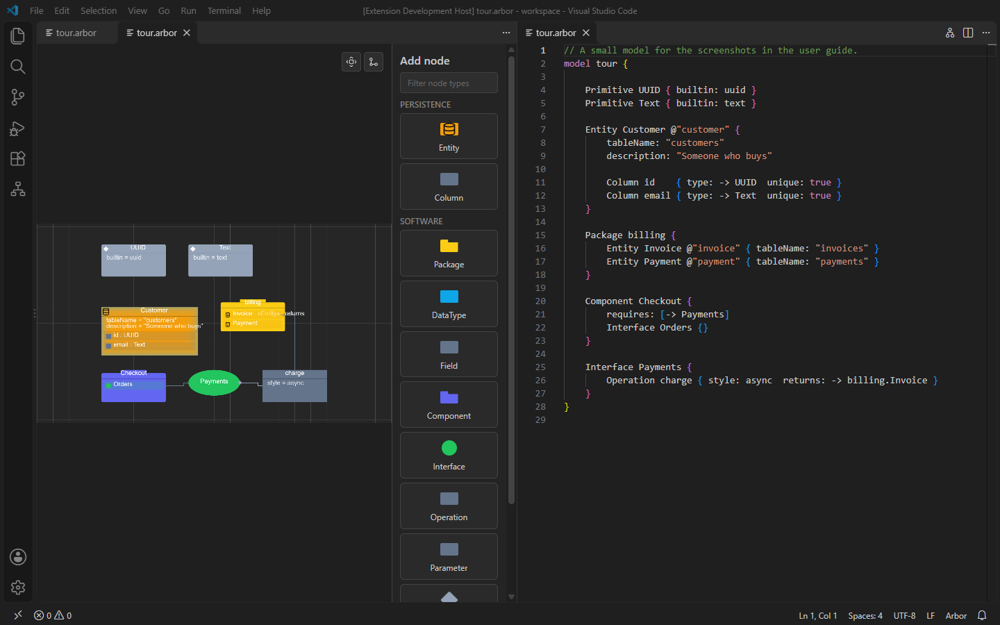
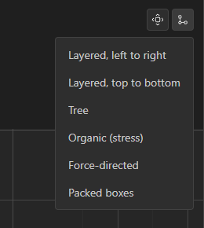
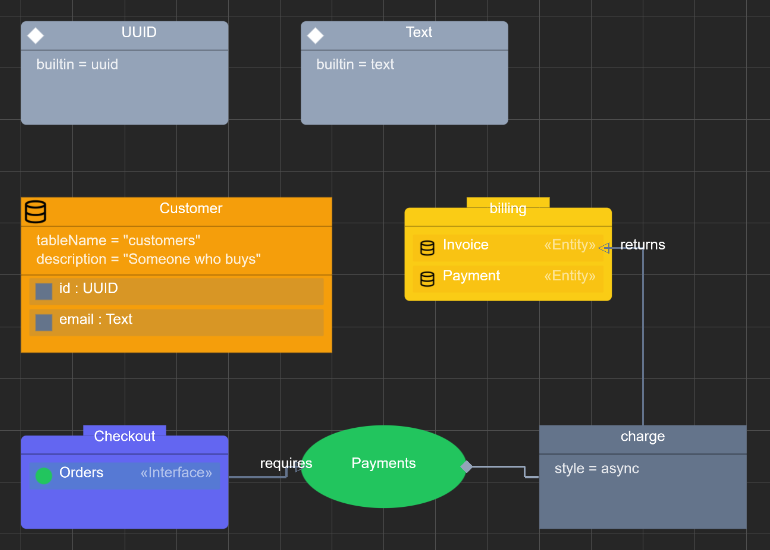
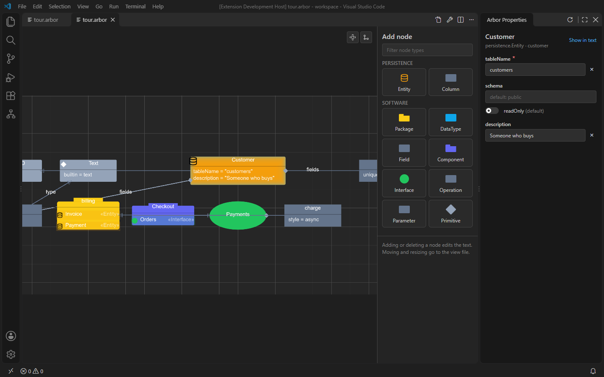
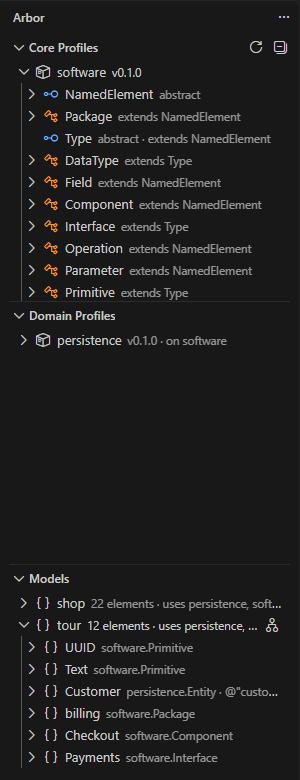

# arbor in VS Code

The extension edits `.arbor` files as text, with the language server's
diagnostics, completion and navigation, and as a diagram. Both views edit the
same file: the text stays the source of truth, and the diagram writes its
changes into it. Where things sit on the diagram is kept separately, in a
`<name>.arbor.view.json` file next to the model.

The screenshots use [examples/tour.arbor](../examples/tour.arbor), a small
model on the `software` and `persistence` profiles.

## Opening a diagram

Open an `.arbor` model and run **Arbor: Open Diagram**, or use the Explorer's
context menu, or **Open Diagram to the Side** on the text editor's title bar.
From a diagram, **Arbor: Open Text** (also on its title bar) opens the text
beside it.

Edits go both ways:

- Typing in the text redraws the diagram.
- Dropping a kind from the **Add node** palette onto the canvas adds an element
  to the text; deleting a node removes it and everything nested in it.
- Moving a node, resizing it and bending an edge only change the view file.
  When you let go, a moved node's edges and a resized node's dragged edges snap
  to the grid lines; hold **Alt** to place them freely. A container, which you
  can't resize, is sized in whole grid steps so its edges stay on the grid too.
- Undo and save are the text editor's: the diagram follows the file.

A file that holds a profile has no diagram of its own: its kinds appear in the
palette of every model's diagram.

### Toolbar

At the top right of the canvas:

- **Fit to view** frames the whole model.
- **Lay out automatically** arranges the model: layered (left to right or top to
  bottom), tree, organic, force-directed, or packed boxes. Edges are routed
  around the nodes with right-angle bends, and those into containers around
  what's inside them. The result is saved to the view file like a move, so
  undoing it means moving nodes back, or restoring the view file.

## How elements are drawn

**Nodes.** An element is drawn as its kind's `visual`: shape, colour, label,
and SVG, image or emoji.

**Properties.** The properties written in an element's text are listed under
its name, one `name = value` line each, like a UML class's attributes:
`Customer` above shows `tableName` and `description`. Profile defaults aren't
listed (they're in the [Properties view](#properties-view)), and references
are drawn as edges instead. Strings are quoted; long lines are cut with `…`.
The lines are text on their node: click one and you select the node.

A node with properties, or one that holds other elements, is drawn as a box
with a header. A kind whose shape isn't a box (`Interface` is a circle) shows
that shape at the left of the header instead, and so does an SVG or emoji. A
node with neither keeps its kind's shape (`Payments` above).

**Containment.** By default an element is joined to what it contains by a
composition edge (◆). It is drawn inside its owner instead when the owner's kind
sets `container: true` (as `Package` and `Component` do in the `software`
profile), or when its own kind sets `member: true`: `Field`, and so `Column`,
are members, so an Entity's columns are rows in its box, like a UML class's
attributes:

- An element that holds no nested elements of its own is a **row**: an icon
  (its kind's shape or SVG), its label, and its kind as a UML stereotype,
  `«Entity»` (not for members, whose kind is clear from their owner). A row
  doesn't list its properties.
- A label can show slots: `Field`'s is `"{name} : {type}"`, so a column reads
  `id : UUID`, and `buyer : User` for a foreign key. A reference shown in the
  label isn't also drawn as an edge; any other reference of the row is, from
  its end.
- An element that does hold nested elements is a box of its own, inside.
- A container arranges its contents in the text's order, in columns of up to 8
  rows, and sizes itself to hold them. It has no resize handles, and its
  contents have no positions in the view file.

**Edges.** References are arrows, labelled with the reference's name. An edge
meets a row at its left or right end, whichever faces the other node. Where
several edges would meet one side of a node at the same spot, their ends are
spread along it, in the order the edges arrive, so their markers don't overlap
(on a crowded row end, the markers also shrink to fit). Where two edges
cross, the more horizontal one hops over the other with a small arc, so a
crossing never looks like a junction. Edges leaving a container are drawn over
it.

**Moving.** Dragging a top-level node moves it; dragging a container moves its
contents with it. An element inside a container goes back where it was when you
let go: its container decides where it goes. (Moving an element to another
container, or reordering it, by dragging is planned.)

## Properties view

The **Properties** view (**Arbor Properties** in the secondary side bar, where
Chat sits) shows a form for the element selected in the diagram you last used.
Every property of its kind is there, defaults greyed out; a change is written
to the text as you type. **Show in text** jumps to the element.

Like any view, it can be dragged elsewhere, collapsed or closed. **Arbor: Show
Properties** (also on the diagram's title bar) brings it back.

## Workspace trees

The **Arbor** activity bar lists the workspace's profiles and models:

- **Core profiles**: profiles that build on no other profile, and their kinds.
- **Domain profiles**: profiles layered on another one.
- **Models**: each model's elements, nested as in the text, with their kinds.

Selecting an item shows it in the text. A model's inline button opens its
diagram, and an element's (**Reveal in Diagram**) selects it in the diagram.

## The view file

`<name>.arbor.view.json` holds, per element ID, the position (and size, if you
resized it) of each top-level node, and the bend points of each edge. It is
written by the diagram only. With Explorer file nesting on
(`explorer.fileNesting.enabled`), it is shown under its `.arbor` file. Elements without an entry are placed automatically, and pinned there
the first time the diagram is opened. Deleting the file resets the layout.

Element IDs come from `@"id"` where an element has one, else from its
qualified name, so renaming an element without an `@"id"` loses its place.

## Known limitations

- The canvas keeps a 16:9 shape, so in a tall, narrow editor (for example
  beside the text) it is letterboxed and the diagram is small.
- Text keeps a readable size as you zoom out, so far out, overlapping labels
  and property lines are hidden until you zoom in.
- Row and property-line widths are estimated, so very wide text can run past
  the edge of its box.
- Moving elements between containers by dragging isn't supported yet.
