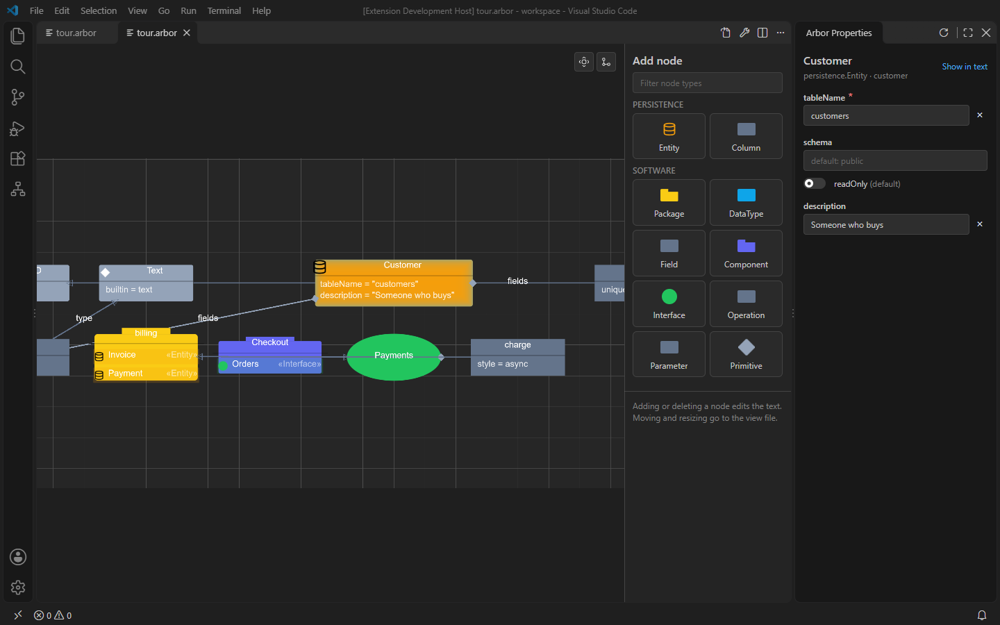
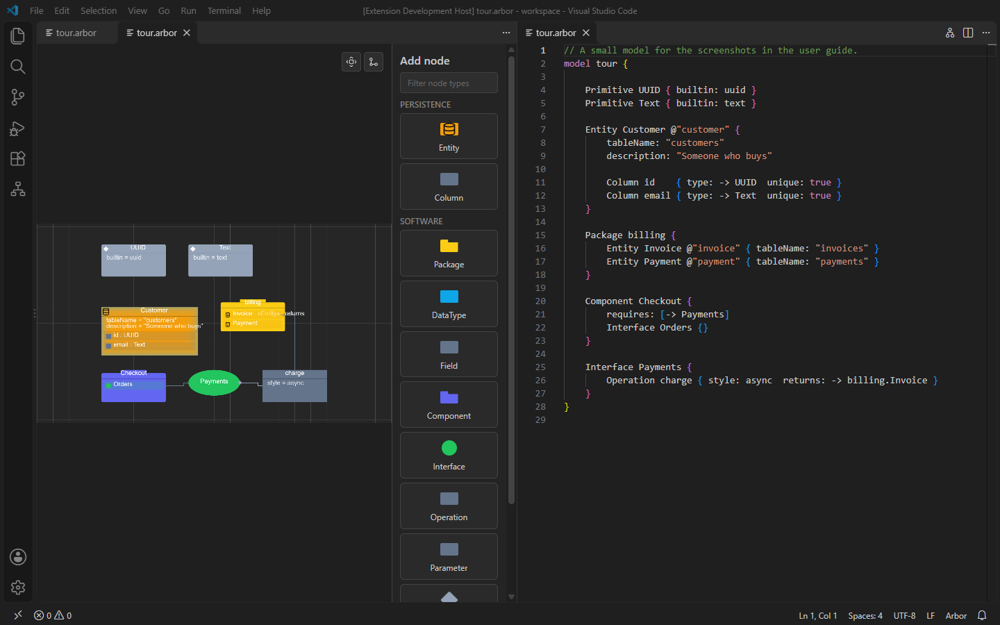
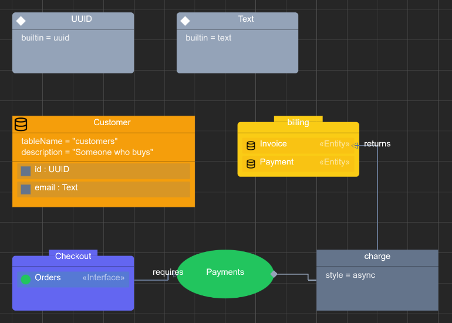

<p align="center">
  
</p>

**arbor** is a small, LLM-friendly meta-modeling language for software
models. You define the kinds of things in your domain in a **profile**, write
**models** of them in one generic syntax, and edit those models as text or as
diagrams, in VS Code or in the browser.

```
 .arbor text ──► Langium AST ──► IR (JSON) ──► diagram (WebGPU)
 (profiles +                        ──► JSON Schema / OpenAPI / DDL …   (planned)
  models)
```



## Contents

1. [What arbor is](#what-arbor-is)
2. [Getting started](#getting-started)
3. [The language](#the-language) ([full reference](LANGUAGE.md))
   - [Two kinds of file, one grammar](LANGUAGE.md#two-kinds-of-file-one-grammar)
   - [Profiles](LANGUAGE.md#profiles)
   - [Models](LANGUAGE.md#models)
   - [Diagnostics](LANGUAGE.md#diagnostics)
4. [Editing in VS Code](#editing-in-vs-code) ([full guide](VSCODE.md))
   - [Opening a diagram](VSCODE.md#opening-a-diagram) and the [toolbar](VSCODE.md#toolbar)
   - [How elements are drawn](VSCODE.md#how-elements-are-drawn)
   - [Properties view](VSCODE.md#properties-view)
   - [Workspace trees](VSCODE.md#workspace-trees)
   - [The view file](VSCODE.md#the-view-file)
   - [Known limitations](VSCODE.md#known-limitations)
5. [Editing in the browser](#editing-in-the-browser)
6. [How it fits together](#how-it-fits-together)

## What arbor is

| Layer | In arbor | Example |
|---|---|---|
| M3, the meta-language | the grammar: `kind`, `prop`, `contains`, `ref`, `enum`, `visual` | fixed |
| M2, your domain | **profiles**: kinds, their features, how they're drawn | [software.arbor](https://github.com/javapak/arbor/blob/main/examples/software.arbor), [persistence.arbor](https://github.com/javapak/arbor/blob/main/examples/persistence.arbor) |
| M1, your system | **models**: instances of those kinds | [tour.arbor](https://github.com/javapak/arbor/blob/main/examples/tour.arbor), [shop.arbor](https://github.com/javapak/arbor/blob/main/examples/shop.arbor) |

- **A new domain is a new profile**, never a grammar change. Profiles are
  data, loaded at runtime: no code generation and no `eval`.
- **Text is the source of truth.** Diagrams edit the text; where things sit on
  a diagram lives in a separate view file, so the model stays clean.
- **Built for LLMs too.** The syntax is small and uniform, every diagnostic
  has a stable code (and often a fix), and the [language
  reference](LANGUAGE.md) is short enough to paste into a prompt.

## Getting started

You need Node 20 or later and, for diagrams, a WebGPU-capable browser or
VS Code. Diagrams use the [webgpu-flow](https://github.com/javapak/arbor/tree/main/webgpu-flow)
renderer, checked out at `webgpu-flow/`.

```bash
git clone --recurse-submodules https://github.com/javapak/arbor
cd arbor
npm install
npm test                             # generate the parser, build, run the tests
npm run check -- examples/*.arbor    # diagnostics, one JSON object per line
npm run ir    -- examples/*.arbor    # the IR
```

Then pick an editor:

- **VS Code:** `npm run extension`, then F5 with the **Arbor extension**
  launch configuration. See [Editing in VS Code](#editing-in-vs-code).
- **Browser:** `npm run studio`, then open http://localhost:5173. See
  [Editing in the browser](#editing-in-the-browser).

## The language

A profile defines kinds; a model is a tree of elements of those kinds:

```
profile persistence version "0.1.0" {
    kind Entity extends software.DataType {
        prop tableName: string [1]
        contains fields: Column [0..*]
        visual { shape: "rectangle" color: "#f59e0b" }
    }
}

model tour {
    Entity Customer @"customer" {
        tableName: "customers"
        Column id { type: -> UUID  unique: true }
    }
}
```

`prop` holds values, `contains` nests elements, `ref` points at other
elements (`-> UUID`), and `visual` says how a kind is drawn, including
whether it draws its contents inside itself (`container: true`) or is drawn
inside its owner (`member: true`).

**Read the [language reference](LANGUAGE.md)** for profiles, models,
qualified names, stable IDs and every diagnostic.

## Editing in VS Code

The extension gives `.arbor` files a language server (diagnostics,
completion, go to definition) and a diagram editor on the same file.



- **Diagram and text stay in step.** Adding or deleting a node edits the text;
  moving, resizing and bending edges only change the view file.
- **Boxes like UML classes.** Properties are listed under a node's name,
  attributes such as an Entity's columns are rows inside it (`id : UUID`), and
  containers such as packages draw their contents inside themselves.
- **Automatic layout** with edges routed around nodes, grid snapping, and edge
  hops where lines cross.
- **A Properties view** in the side bar to edit the selected element.



**Read the [VS Code guide](VSCODE.md)** for all of it, with screenshots.

## Editing in the browser

The studio (`apps/studio`) puts a text editor and the diagram side by side in
the browser, with the same diagram, palette and layout toolbar as VS Code.
Every text change redraws the diagram; adding or deleting a node edits the
text. Files and layout are kept in the browser's local storage, and **Reset
to examples** starts over.

```bash
npm run studio      # http://localhost:5173
```

## How it fits together

Nothing converts directly to anything else: importers produce the IR, and
everything downstream reads it.

| Package | Purpose |
|---|---|
| `@arbor/ir` | the IR's types and JSON Schema, read helpers (inheritance, defaults, visuals) |
| `@arbor/language` | the grammar, validator, AST → IR, CLI and language server |
| `@arbor/adapter-flow` | IR → diagram nodes and edges, with layout from the view file |
| `@arbor/property-form` | the form for one element's slots, from its kind's schema |
| `apps/vscode` | the VS Code extension |
| `apps/studio` | the browser studio |

More detail, and the design decisions so far, are in the
[README](https://github.com/javapak/arbor#readme).
